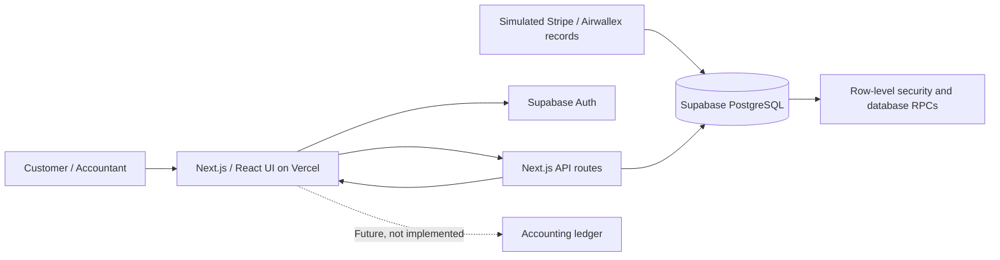

# Booksly — Product & Technical Assessment

**Trust before automation**  
**Market:** Singapore (initial assumption)  
**Prototype:** https://booksly-liard.vercel.app  
**Source:** https://github.com/MeelisGitDev/Booksly

## 1. Executive summary

Booksly explores a focused way to reduce repetitive bookkeeping work for small businesses: ingest payment and banking activity, propose how each transaction should be handled, and route uncertainty to the person best placed to resolve it. The core proposition is **exception-driven bookkeeping with explicit human control**, not fully autonomous accounting.

The prototype demonstrates a shared customer–accountant workflow with 12 simulated Stripe and Airwallex transactions. It supports transaction review, customer clarifications, accountant classification corrections and approvals, an audit trail, authenticated access and Supabase-backed persistence. **It does not connect to live providers, execute live AI classification, upload or verify documents, calculate GST, reconcile accounts automatically, or post entries to an accounting ledger.**

The intended outcome is fewer manual touches per routine transaction, while preventing unsupported or ambiguous records from silently entering the accounting system.

## 2. Problem and users

A small-business accountant may need to reconcile multiple payment and banking sources, identify the business purpose of transactions, find supporting evidence, resolve missing invoices and decide the appropriate accounting treatment. The work is fragmented: the accountant often has the transaction but not its context; the customer has the context but may not know what the accountant needs.

**Primary users**

- **Customer / business operator:** answers targeted questions and supplies missing context or evidence.
- **Accountant / bookkeeper:** reviews proposals, corrects classifications, resolves exceptions and approves eligible items.
- **Workspace administrator:** manages the demo environment; the current reset function is an administrative demo operation, not a production bookkeeping feature.

**Jobs to be done:** make routine items easy to process, make exceptions visible and actionable, and preserve an understandable history of who decided what.

## 3. Product decisions and rationale

| Decision | Rationale | Trade-off |
| --- | --- | --- |
| Start with Stripe and Airwallex-shaped sample activity | Represents a realistic mix of payment proceeds, fees, expenses and transfers | Provider connections are not yet proven |
| Prioritise an exception queue over a broad accounting feature set | Focuses effort on transactions that actually need attention | Does not replace an accounting platform |
| Separate customer clarification from accountant approval | The customer knows the business context; the accountant owns accounting judgement | Some items require an additional handoff |
| Keep the accounting ledger as the eventual system of record | Avoids treating a prototype's internal statuses as posted accounting entries | Approval is not yet end-to-end completion |
| Use explicit statuses and version checks | Makes handoffs and stale decisions easier to detect | More state-management complexity |
| Retain audit events | Supports reviewability and accountability | Audit quality depends on complete server-side enforcement |
| Use simulated AI proposals and evidence | Tests the workflow before investing in provider, OCR and model integrations | Does not establish classification accuracy or automation savings |

**Guiding principle:** a plausible AI suggestion is not sufficient evidence for a financial posting. Confidence, required evidence, business rules and accountant approval must be considered separately.

## 4. Demonstrated workflow

### Routine transaction

1. A simulated provider transaction appears with a proposed classification and `READY` status.
2. The accountant opens it, checks the available context and audit history, and approves if appropriate.
3. The item moves to `APPROVED`, with the action reflected in its history.
4. **The prototype stops here:** no journal entry or ledger export is created.

### Exception requiring customer input

1. A transaction is marked `NEEDS_CUSTOMER` because an invoice or business explanation is missing.
2. The customer opens the item and submits a clarification.
3. The item returns to an accountant-reviewable state according to the installed database workflow.
4. The accountant evaluates the response, corrects classification if necessary and approves only when justified.

### Accountant exception

An ambiguous item marked `NEEDS_ACCOUNTANT` is reviewed by the accountant, who can change its category or take an eligible approval action. The API submits the selected transaction's current version; stale decisions can be rejected with HTTP 409 rather than silently overwriting another action.

The dataset also illustrates a Stripe gross payment, processing fee and Airwallex settlement as related activity; this is **not** a functioning automatic reconciliation engine.

## 5. Current implementation and architecture

- **Frontend:** Next.js 15, React 19, TypeScript; overview, transactions, review queue and detail actions.
- **Identity:** Supabase Auth; server middleware protects pages and API requests. The **Demo view** customer/accountant selector is a visual preview, **not** an authorization control.
- **Persistence:** Supabase PostgreSQL, including company memberships, transactions, classifications and audit logs. Current routes use Supabase rather than the legacy local JSON store.
- **Actions:** `POST /api/action` validates requests, resolves transaction identifiers and calls database functions for transitions; the client sends a proposal version.
- **Isolation:** database row-level security is used for access control. Exact SQL policies and RPC definitions are maintained outside the checked-in repository, so they cannot be independently audited or reproduced from the code alone.
- **Deployment:** Vercel; the public entry point redirects unauthenticated users to sign-in. Production workflow permissions still require testing with actual role-specific accounts.

See [`technical-overview.md`](technical-overview.md) and [`functions.md`](functions.md) for implementation detail. The repository currently lacks SQL migrations and the database function definitions needed to reproduce the Supabase backend from scratch.

## 6. Singapore-first assumptions and scope

Singapore is the initial target market for the exercise, not evidence that regulatory or market fit has been validated. The prototype displays SGD and uses Singapore-oriented sample transactions. Before production use, we would validate accounting workflows with local practitioners, including GST treatment where applicable, evidence retention requirements, business entity structure and the target accounting system's posting model.

**In scope for this prototype:** transaction visibility, exception routing, customer answers, accountant decisions, approval states, audit visibility, authentication and persistence.

**Out of scope:** live Stripe/Airwallex ingestion and webhook reliability; OCR or actual attachment handling; model inference and confidence calibration; GST determination; full reconciliation; accounting export; production onboarding, billing and operational monitoring.

## 7. Execution plan — Product Lead + two Product Engineers

The following is a **proposed next-stage plan**, not work already completed. Sequence the work around risk reduction and a narrow pilot rather than a feature-complete accounting suite.

| Stage | Product / Technical Lead (me) | Product Engineer A | Product Engineer B | Exit evidence |
| --- | --- | --- | --- | --- |
| **1. Validate (week 1)** | Interview 3–5 accountants/business operators; define transaction taxonomy, exception rules, pilot metrics and target ledger | Review existing API, role model, SQL/RLS/RPC definitions and tests | Map Stripe/Airwallex event and settlement data; define idempotent import contracts | Agreed workflow, acceptance criteria, data contract and security baseline |
| **2. Connect (weeks 2–3)** | Prioritise one end-to-end provider path; review data-quality edge cases | Implement one provider integration, sync checkpoints, deduplication and observability | Implement evidence capture and exception UX with validation | Repeatable ingestion; duplicate/retry tests; traceable exceptions |
| **3. Control (weeks 3–4)** | Define approval policy, escalation thresholds and ledger mapping with accountant | Harden state transitions, role enforcement, concurrency and audit invariants | Build deterministic classification rules and controlled AI suggestion experiment | Role/security tests; measured suggestion quality; no unapproved posting |
| **4. Pilot (weeks 5–6)** | Run supervised pilot, review weekly metrics and make go/no-go decision | Build sandbox ledger export with idempotency and reconciliation checks | Improve customer question flow and exception resolution feedback | Demonstrated closed-loop sample; pilot results and rollback procedure |

The stages overlap where practical; exact duration depends on provider permissions, accounting-system selection and access to pilot users. **The first engineering priority is to export/version the database schema and policies**, because the current repository cannot fully recreate the backend.

## 8. Measuring success

A baseline must be measured with pilot accountants before claiming time savings. Suggested metrics:

| Metric | Definition | Why it matters |
| --- | --- | --- |
| **Manual handling time per transaction** | Active accountant minutes / completed transactions, segmented by routine vs exception | Primary measure of effort reduction |
| **Straight-through eligibility rate** | Share of imported transactions meeting deterministic completeness and policy checks | Indicates potential automation, not automatic posting |
| **Exception rate and age** | Share requiring input; median/p90 time until resolved | Shows bottlenecks and customer responsiveness |
| **First-pass proposal acceptance** | Accountant-approved proposals without reclassification / reviewed proposals | Measures suggestion usefulness; monitor by category |
| **Correction / rework rate** | Reopened or corrected items / approved items | Detects quality deterioration |
| **Evidence completeness** | Items with required supporting context / items requiring evidence | Tests readiness for accounting review |
| **Import duplication and failure rate** | Duplicate or failed ingestion events / provider events | Validates integration reliability |
| **Unauthorized action / posting incidents** | Count of policy violations or entries posted without required approval | Safety guardrail; target zero |

Segment by source, transaction type, accountant and customer; avoid interpreting a small curated demo dataset as performance evidence. Pilot success should require both a meaningful reduction in manual effort **and** no deterioration in accounting correctness.

## 9. Risks, mitigations and production gates

- **Incorrect classifications or hallucinated evidence:** deterministic validation, evidence requirements, confidence thresholds, human review and explicit uncertainty; never invent invoices.
- **Duplicate or missing imports:** provider event IDs, idempotency keys, sync cursors, retry handling and reconciliation to provider totals.
- **Wrong-user or cross-company access:** server-enforced roles, tenant-scoped queries, RLS/RPC review, negative authorization tests and secure audit logs.
- **Concurrent decisions:** proposal version checks, transactional updates and conflict feedback; avoid silent last-write-wins.
- **Uncontrolled ledger posting:** accounting system remains source of truth; require explicit posting policy, idempotency, dry-run, reconciliation and rollback before enabling exports.
- **Regulatory mismatch:** verify Singapore-specific tax, retention, privacy and accounting obligations with qualified local professionals before launch.
- **Non-reproducible infrastructure:** version schema, migrations, RLS and functions; maintain separate demo credentials and environment setup.

**Go/no-go gates:** tested tenant isolation and roles; documented data contract; repeatable ingestion; verified approval rules; observable audit trail; accountant-approved ledger mapping; measured pilot quality and time savings.

## 10. AI usage disclosure

I used **ChatGPT and coding assistance (including Codex)** to accelerate prototyping, UI iteration, debugging, documentation and solution review. I remained responsible for defining the workflow, evaluating the trade-offs and checking the running application. The sample classifications and evidence are **simulated**; the prototype does **not** call a live AI classification service. No model-accuracy or effort-reduction claim is inferred from the sample records.

## 11. What I would do differently with more time

1. Check in database migrations, RLS policies and RPC definitions first, with automated tests against a disposable database.
2. Replace the cosmetic role preview with an authenticated role-aware interface and verify all customer/accountant/admin permissions end to end.
3. Build one real provider-to-accountant-to-ledger sandbox flow before expanding the number of integrations.
4. Collect representative, anonymized transaction samples and measure baseline effort and error rates before introducing AI.
5. Add robust evidence handling, observability, recovery procedures and production-grade security review.

## 12. Reviewer walkthrough

1. Open the [live demo](https://booksly-liard.vercel.app) and sign in using **separately supplied demo credentials**. Credentials are not stored in this repository.
2. Review the overview and 12 simulated transactions.
3. Open a `READY` transaction and inspect the proposed classification and audit history.
4. Using the customer account, answer a `NEEDS_CUSTOMER` item.
5. Using the authorized accountant account, review the answer, reclassify an exception if appropriate and approve an eligible item.
6. Observe that actions persist and appear in the audit trail; note that approval does not create a ledger entry.
7. If an administrator has provided access, use **Reset demo** to restore the demonstration dataset.

**Review note:** the UI's **Demo view** switch only previews screen variations. To test real authorization, sign in with the corresponding user account. Share passwords privately, not in GitHub.
