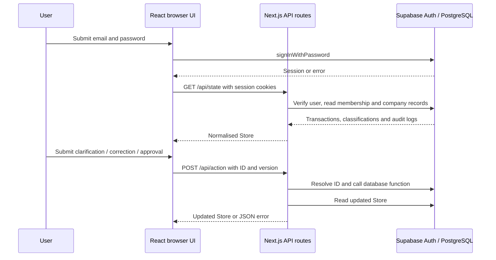

# Booksly technical guide

Booksly is a Singapore-first bookkeeping prototype built with Next.js 15, React 19, TypeScript and Supabase. Authentication and persistence use Supabase Auth and PostgreSQL. Provider imports, AI proposals and document evidence remain simulated; approval does not post to an accounting ledger.

## Start here

Read these files in this order:

1. [`lib/types.ts`](../lib/types.ts): the data shapes used by the UI.
2. [`app/login/page.tsx`](../app/login/page.tsx): signing in and managing form state.
3. [`app/page.tsx`](../app/page.tsx): loading data, rendering the dashboard and submitting actions.
4. [`app/api/state/route.ts`](../app/api/state/route.ts) and [`lib/supabase-store.ts`](../lib/supabase-store.ts): how database rows become UI data.
5. [`app/api/action/route.ts`](../app/api/action/route.ts): how changes reach the database.
6. [`lib/supabase-server.ts`](../lib/supabase-server.ts): how server requests carry the user's session.

The [function reference](functions.md) is generated from the JSDoc comments beside each function and callback. Those comments also appear in editor hover tooltips where supported. Run `npm run docs` after editing them. The generator requires a comment for every function in `app`, `components`, `lib` and the root `middleware.ts`; it does not connect to Supabase.

## How the parts connect



## Browser and server code

`"use client"` marks the login, dashboard and sign-out component as interactive React entry points. Their event handlers run in the browser. `useState` keeps values between renders; calling a setter schedules a UI update. The dashboard's `useEffect` loads state after mounting, and `useMemo` calculates counts from the current rows.

Files named `route.ts` under `app/api` define HTTP handlers that run on the server. Next.js connects an exported `GET` or `POST` function to that HTTP method. `NextResponse.json` creates a JSON response with an HTTP status code.

`app/layout.tsx` wraps pages in shared HTML and imports `app/globals.css`. Next.js also discovers `app/icon.svg` as the favicon. The workspace title currently displays a hardcoded demo company name; it is not derived from membership data.

## TypeScript terms used here

| Syntax | Meaning in Booksly |
| --- | --- |
| `type Transaction = { ... }` | A compile-time description of transaction fields. |
| `Status = 'READY' \| ...` | A union: only these status strings are allowed by the type checker. |
| `Store \| null` | Data may be loaded, or absent while waiting. |
| `Promise<Store>` | An asynchronous function eventually resolves to a Store, or rejects with an error. |
| `reason?: string` | An optional property that may be missing. |
| `row.description ?? ''` | Use the fallback only when the original value is null or undefined. |
| `t?.version` | Read the version safely when `t` might be undefined. |
| `Record<string, unknown>` | An object with string keys whose values need checking before use. |
| `as ClassificationRow` | Tell TypeScript to treat a value as this shape; it does not validate runtime data. |
| `process.env.NAME!` | Tell TypeScript the value exists; missing environment variables can still fail at runtime. |
| `.map(...)` / `.filter(...)` / `.find(...)` | Transform a list / select matching items / find its first match. |

TypeScript checks code before it runs. It does not automatically validate JSON sent over HTTP. The action route includes explicit runtime checks for the action name, ID and integer version; further validation is delegated to the database function.

## Supabase clients and sessions

- [`lib/supabase.ts`](../lib/supabase.ts) exports a browser client used by login. Its publishable key is intended for public client configuration; database access still depends on policies and the session.
- [`lib/supabase-server.ts`](../lib/supabase-server.ts) creates a client for the current request. Cookie adapters let Supabase read and attempt to update session cookies. API routes use `auth.getUser()` to verify the caller.
- [`components/LogoutButton.tsx`](../components/LogoutButton.tsx) creates a browser client, signs out, then replaces the URL with `/login` and refreshes server data.

The dashboard's customer/accountant selector changes local display state only. Real roles come from company membership records and database authorization. The UI does not send the preview role to `/api/action`. The dashboard requests data on mount. Before any page renders, [`middleware.ts`](../middleware.ts) verifies identity with `auth.getUser()`: unauthenticated page requests redirect to `/login`, authenticated requests to `/login` redirect to `/`, and unauthenticated API requests return JSON with HTTP 401. Existing route-level authentication checks remain in place. The middleware forwards refreshed cookies to both downstream server code and the browser, including on redirects and errors, and disables shared caching of auth-dependent responses. Static Next.js assets and the favicon are excluded from the matcher. Next.js 15 uses `middleware.ts`, not the newer `proxy.ts` filename.

## Data model and database adapter

The UI uses `Store = { transactions, updatedAt }`. A transaction contains its provider, amount, category, evidence, status, proposal version and audit events. `updatedAt` is created when the adapter builds a response; it is not the latest database modification timestamp.

`readSupabaseStore` reads `company_members` for the authenticated user and selects the first membership. It then reads that company's `transactions` with related `classifications` and `audit_logs`. It converts snake_case database fields to UI fields, converts amounts to numbers and sorts audit events oldest first. Details display those events in reverse order. The adapter takes the first classification when the relation returns an array and throws if it is missing or its status is unknown.

| Database classification status | UI status | Intended next step |
| --- | --- | --- |
| `ready_for_review` | `READY` | Accountant review. |
| `needs_customer` | `NEEDS_CUSTOMER` | Customer supplies clarification. |
| `needs_accountant` | `NEEDS_ACCOUNTANT` | Accountant reviews evidence or classification. |
| `approved` | `APPROVED` | Display approval and audit history; no ledger posting. |

The sample records illustrate a Stripe gross payment, fee and Airwallex settlement in one reconciliation group. A settlement is represented as an internal transfer. No live reconciliation engine runs here.

## HTTP endpoints

| Method and path | Response / behaviour |
| --- | --- |
| `GET /api/state` | Primary UI Store, filtered to the first company membership; caching disabled. Authentication failure returns 401; other caught errors return 500. |
| `GET /api/state-db` | Alternative route with the same Store adapter and error handling. |
| `GET /api/me` | Authenticated email and memberships with company details and stored roles; 401 if not authenticated, 500 on membership query failure. The dashboard does not currently call it. |
| `GET /api/transactions` | Raw database-shaped rows with nested classifications and a count. Uses RLS visibility without the adapter's explicit first-company filter. Returns 401 or 500 on authentication/query failure. |
| `POST /api/action` | Performs a supported action, then returns the updated Store; caching disabled on success. |
| `GET /api/health` | Requires a verified user and queries at most one visible company using the request server client under RLS. Returns 401 without a session. Query success, even with zero rows visible, does not prove full database health. |

Examples of action bodies:

```json
{ "action": "customer_answer", "id": "tx02", "version": 1, "answer": "Invoice AWS-123" }
```

```json
{ "action": "reclassify", "id": "tx03", "version": 2, "category": "Professional services" }
```

```json
{ "action": "approve", "id": "tx03", "version": 3 }
```

```json
{ "action": "reset" }
```

Versions above are illustrative: the UI sends the selected transaction's current version. The route resolves the demo ID to a PostgreSQL UUID under RLS, then calls `apply_bookkeeping_action` with `p_transaction_id`, `p_action`, `p_version`, `p_answer` and `p_category`. The version supports detecting stale proposals when another action has changed the data. Database errors containing `Refresh before acting` become HTTP 409; other action errors become 400. The UI displays the message; it does not automatically retry or refresh after a conflict.

Reset asks for browser confirmation and calls `reset_booksly_demo` through the API. It is a database operation, not a browser-only reset. Its scope and permissions are defined by the installed database function. Reset RPC errors return 403. Other action responses include 401 for unauthenticated requests, 400 for invalid request fields, 404 for an unsuccessful transaction lookup and 500 for unexpected caught errors.

## Database definitions outside this checkout

This repository contains client queries and RPC calls, but no SQL definitions or migrations for its current tables, RLS policies or database functions. The code expects `company_members`, `companies`, `transactions`, `classifications`, `audit_logs`, `apply_bookkeeping_action` and `reset_booksly_demo` to exist in the configured Supabase project. Exact authorization rules, atomicity and transition enforcement must be checked against those installed definitions; they cannot be verified from this checkout alone.

[`lib/store.ts`](../lib/store.ts) and [`lib/seed.ts`](../lib/seed.ts) remain as legacy local-demo helpers. Current API routes do not import them. The running application does not use `data/state.json` as its persistence layer.

## Development and verification

Install dependencies with `npm install`. Configure the two public Supabase values shown in [`.env.example`](../.env.example) in a local `.env.local`, then run `npm run dev`. This connects to the Supabase project you configure; it does not provision a database or install missing SQL functions.

- `npm run docs`: regenerate the function reference from source comments.
- `npm run build`: compile and run the Next.js production build checks.
- `npm start`: serve an existing production build.

A successful build checks compilation and types; it does not exercise real authentication, database policies or RPC behaviour. Run `node --test scripts/auth.test.mjs` for middleware regression tests covering redirects, 401 responses and refresh-cookie propagation. These tests simulate Supabase Auth results with real Next.js request/response objects; they do not exercise live sign-in or database role policies. Use the customer and accountant accounts from your own configured demo environment to check each workflow; the preview selector cannot grant their permissions.

## Authentication verification after deployment

The earlier public dashboard was statically rendered without a server authentication gate. API authentication alone did not prevent visitors from seeing its UI. The middleware now runs before that page can be served and applies `Cache-Control: private, no-store` to its response.

After deploying, use a fresh Incognito session to confirm `/` redirects to `/login`, and both `GET /api/state` and `POST /api/action` return 401 without cookies. Sign in with real customer, accountant and admin demo accounts to check their existing database permissions and workflows. Sign out and request `/` again. SQL policies and RPC definitions remain external to this repository and are unchanged by this fix.

The implementation follows the [Supabase SSR client and middleware guidance](https://supabase.com/docs/guides/auth/server-side/creating-a-client?queryGroups=framework&framework=nextjs), including the Next.js 15 filename and preservation of refreshed session cookies and cache headers.
